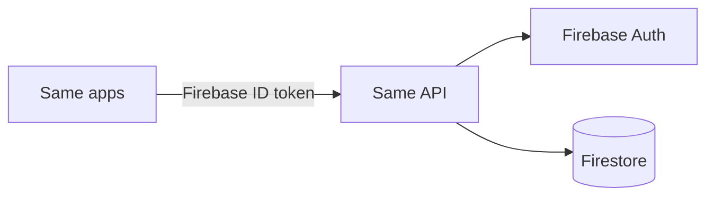

# Same API

REST API for **Same**, a social network for students in Geneva.


## Table of contents

- [Overview](#overview)
- [Architecture](#architecture)
- [Getting started](#getting-started)
- [API](#api)
- [Project structure](#project-structure)
- [Data model](#data-model)
- [Contact](#contact)

## Overview

The Same API is the single entry point for all Same clients. It owns authentication, business rules and data access, and sits in front of Firebase so that clients never talk to the database directly.

**Currently supported**

- User profiles, including private accounts
- Follow and unfollow
- Posts with an optional image
- Comments with nested replies

## Architecture



Clients sign in with Firebase and send the resulting ID token to the API. The API verifies the token, applies the business rules, and reads or writes Firestore on the caller's behalf.

**Stack:** .NET 10 · ASP.NET Core · MediatR · AutoMapper · FluentValidation · Firebase Auth · Firestore · Docker

## Getting started

### Prerequisites

- [.NET 10 SDK](https://dotnet.microsoft.com/download)
- A Firebase project with Authentication and Firestore enabled

### Configuration

Set the following in `appsettings.Development.json` or as environment variables:

```json
{
  "Firestore": {
    "ProjectId": "<firebase-project-id>",
    "DatabaseId": "(default)"
  }
}
```

Credentials are never committed. Use environment variables or a secret manager.

### Run

```bash
git https://github.com/Same-school/SameAPI.git
cd Same
dotnet run --project SameApi.App
```

### Run with Docker

```bash
docker build -t same-api .
docker run -p 8080:8080 same-api
```

## API

Every endpoint except `/health` requires a Firebase ID token:

```http
Authorization: Bearer <firebase-id-token>
```

Requests and responses use JSON. Swagger UI is served by the running API.
## Project structure

```
SameApi
├── SameApi.App        Entry point and HTTP configuration
├── SameApi.Business   Use cases, validation, mapping
├── SameApi.Data       Base context and repositories
├── SameApi.Db         DbContext and Unit of Work
├── SameApi.Dto        Data transfer objects
└── SameApi.Model      Domain models
```

## Data model

The data model is described in [MLD](./MLD.md).

## Security

To report a vulnerability, please read our [security policy](./SECURITY.md).

## Development environment

To get an authentication token for local development, see [Getting a token](./HOWTOGETTHETOKEN.md).

## Contact

[same@sames.school](mailto:same@sames.school) · [@mattis-adam](https://github.com/mattis-adam)